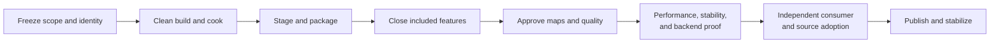

# First Release Acceptance Contract

Use this contract to decide whether exact release bytes may ship. Make product choices in [Release Scope](ReleaseScope/README.md#approval-and-next-work); choose implementation work in [Roadmap](../Strategy/Roadmap.md#where-we-are-and-what-is-next).

**Status:** acceptance contract for the first public engine release; requirements are not completion claims

**Release target:** SparkleEngine `v0.1.0`, Windows x64

**Current readiness:** feature implementation/integration portfolio **40/100**; release acceptance **0/100**. All 49 tracked feature families remain Blocked, no passing candidate-bound feature report exists, and no release gate has passed. Deferred decals, color grading, chromatic aberration, basic vignette, and HDR10 output are mandatory **0/100** blockers. The newly admitted vignette does not automatically rescore the historical portfolio. See [Current Feature Readiness](CurrentReadiness.md).

## Current FR-01 Blockers

**Latest licensing work:** [ITER-REL-01-08](ReleaseScope/Evidence.md#feature-preserving-licensing-iter-rel-01-08), 2026-10-11, at `7cfceb32d10e487637ed482fbc80d6dcce5f88e2` plus the recorded patch. Earlier baseline evidence remains candidate-bound: Clean baseline candidate `263dfbf8ee509b883a78d43d09d47a50a48190b8`; source-export child `bbec6c12ae34a31f159961a12ad64079cb589ea1`. `REL-01` and ordered `REL-02` admission remain **BLOCKED**; the local baseline itself passes.

| Item | Result / next action |
| --- | --- |
| Clean baseline | **PASS:** absent-cache configure, Shipping Game and Launcher/three cook-tool builds, existing owner checks, Empty cook, Launcher/Game activation and normal exits. Warm disconnected and process HTTP-denied cache replay pass. Exact commands, versions, hashes, outputs and cleanup are in the [candidate report](ReleaseScope/Evidence.md#fr-01-closure-work-iter-rel-01-07). Editor/seven-map/FPS/package/clean-host proof is not claimed. |
| Immutable inputs / provenance | **PASS, audited baseline:** source revisions and SDK archive members are verified; Font Awesome font/license URLs and hashes are now pinned. Selected-model notices and four exact Poly Haven sky-source matches are retained. Expected zlib generated cache mutation is disclosed. Installed toolchain prerequisites remain host-specific. |
| Sponza and source export | **PASS for acquisition recipe/export membership:** seven maps remain supported selections; initial selection is Empty. Classic Sponza uses a pinned, verified 72-file recipe; old bundled mesh/texture files are removed with local byte-verified backups. Reviewed source export excludes uncleared Sponza bytes/thumbnails and other unqualified development content. **BLOCKED for raw public history:** existing GitHub history still contains uncleared asset bytes. Obtain an applicable grant or authorize a concrete remote/history remediation; no public history or visibility was changed. |
| Cornell Box | **Normal launch prerequisite fixed:** tracked licensed GLB and attribution retained, unnecessary OBJ download removed. Optional regeneration archive receipt is still unavailable; it does not block normal map sync. Cornell render/package proof belongs to later gates. |
| Redistribution review | **Prepared:** NVIDIA staging copies the same eight runtime DLLs with five verified notice files; exact Qt source companions/vendor provenance are verified. Package notice/source publication, prominent Qt notice, compatible DLL replacement and NVIDIA distribution terms still require acceptance. Pinned dependencies, notice inventories and the [release input owner](../Architecture/Modules/BuildAndPackaging/ReleaseInputs.md) provide inputs; development deployment is not an accepted package. Keep `sl.dlss_d.dll` as the required Ray Reconstruction plugin. |
| Signing | **Route decided:** Certum Standard Code Signing in the Cloud for individual Pawel Lisowski, SimplySign/Windows SDK SignTool, SHA-256/RFC 3161. **Deferred by owner:** enrollment/payment/identity verification is a final pre-release roadmap task before signed candidate freeze/adoption. Certificate absence does not block FR-01 or unsigned internal package development; final public bytes still require trusted signatures. |
| Phase transition | **BLOCKED:** close public asset-history and redistribution review first. Local build/cook/activation success does not authorize publication or accept FR-02. |

**Receipts:** `build/validation/fr01-closure-20261011/`; [ITER-REL-01-07](ReleaseScope/Evidence.md#fr-01-closure-work-iter-rel-01-07) binds every observation to its candidate and names unavailable checks. Earlier reports remain historical.

## Read This Page

- **Understand the release:** [Product promises](#what-the-first-release-delivers) and [required rendering](#required-rendering-closure).
- **Evaluate a candidate:** [Release gates](#release-gates), [failure controls](#failure-mode-acceptance-matrix) and [stability](#candidate-stability-matrix).
- **Prepare approval:** [Evidence package](#release-evidence-package) and [approval rules](#approval-rules).

## Release At A Glance

| Question | Current answer |
| --- | --- |
| What is the intended product? | Sparkle Launcher, Sparkle Editor and Sparkle Game, with seven user-selected release maps, intentional Empty startup and user/display-selected resolution; Launcher is the expected user entry point. Game targets 30 FPS on the named laptop. No user support service is offered. |
| What exists? | Broad engine, tooling, content, Renderer, and D3D12/Vulkan source paths plus focused development workflows. |
| Where are we now? | Feature portfolio **40/100**, release acceptance **0/100**, `Blocked`; no frozen candidate has passed the clean build/cook/package, feature, map, backend, performance, stability, adoption, publication, and stabilization gates. |
| What is the largest product gap? | There is no accepted manifest-owned release package or clean-machine consumer/source-adopter record. |
| What is the reading rule? | Use [release gates](#release-gates) for the proof required to ship and the [dated audit](#current-release-audit) for recorded blockers. |



## Release Gates

Gates are strictly ordered. A later gate may be prepared, but it cannot be accepted while an earlier gate is red.

| Gate | Exit criteria | Required artifact |
| --- | --- | --- |
| `REL-00 Scope and freeze` | Launcher/Editor/Game and source-adopter promises, platform/no-support/budget matrix, feature classifications, public/compatibility/non-goals, and release roles are frozen. | Approved [Release Scope](ReleaseScope/README.md) and [Capability Dispositions](ReleaseScope/CapabilityDispositions.md), exported into candidate `release-scope.md` with audience journeys and compatibility decisions; exact rights receipts remain required. |
| `REL-01 Identity, rights, supply chain, and map set` | Version/publisher/license are real; exact `ReleaseMapSet`, immutable dependency closure, signing/distribution route, threat model, SBOM plan, notices, and redistribution decisions are reviewed. | Identity/signing decision, threat model, dependency/license/SBOM inventory, notices audit, and map manifest. |
| `REL-02 Clean reproducible baseline` | Clean tagged-source candidate performs empty-cache dependency sync, configure, named Shipping build, approved checks, and warm/offline-cache replay; validation and any explicit test authorization are recorded. | Environment/provenance manifest and raw sync/build/check logs. |
| `REL-03 Package spine` | One command performs Build, Cook, Stage, Verify, and Package with an explicit signing step available before final candidate freeze. Unsigned internal development archives are permitted while certificate enrollment is deferred; they do not qualify public release or `REL-08`. The allowlisted staged tree has immutable content, per-user writable state, dependency closure, SBOM, hashes, and no repository path dependency. | First non-candidate archive, package inventory, explicit signature status, SBOM, and created-path record; final signatures required before `REL-08`. |
| `REL-04 Current feature closure` | Every current surface is `Included`, `Experimental`, `Excluded`, or `Removed`; every included/experimental row has a complete how-it-works/polish report and passes its subsystem integration/failure criteria. | Approved feature-closure matrix and candidate-bound completion reports. |
| `REL-05 Map correctness and PBR` | Every release map passes end-to-end, artifact, PBR, debug-view, reference, and temporal review on each included backend. | Per-map evidence packages and defect disposition. |
| `REL-06 Performance and stability` | Every release map meets the 30 FPS floor; load/soak/repeat/resize/switch/shutdown and memory gates pass on the supported matrix. | Raw timings, captures, memory records, and stability log. |
| `REL-07 Native backend diagnostics` | D3D12 and Vulkan validation passes are clean or every finding is resolved/classified; crash/device-loss diagnostics are actionable. | API validation logs, captures, driver matrix, and incident records. |
| `REL-08 Clean-machine candidate` | The signed frozen bundle starts all three products as a standard user, performs user-selected sync and completes Editor/Game journeys offline afterward on minimum/reference machines, with read-only install, per-user state, integrity, compatibility, and failure checks. | Candidate hashes/signatures, clean-machine record, filesystem/network inventory, screenshots, and logs. |
| `REL-09 Independent release approval` | A non-author completes both consumer and source-adopter journeys from public instructions; all failure-mode checks pass; zero open `S0`/`S1`; waivers and known issues are approved. | Signed go/no-go checklist, consumer report, source-adopter report, and negative-test ledger. |
| `REL-10 Publish and verify` | The installed-consumer compatibility policy is effective; tag/artifact bytes are immutable; uploaded hashes/signatures/attestation match; fresh downloads pass all three product journeys and shortest source checks; notes/notices and the no-support statement are accurate. | Published URL/tag, checksums/signatures/attestation, retrieval logs and final policy. |
| `REL-11 Stabilize and close` | A bounded maintainer release review is completed, known candidate defects are dispositioned, any replacement/withdrawal has exact provenance, and no unresolved `S0`/`S1` remains. No ongoing user support or response window is required. | Release-review ledger, any patch/withdraw records, retrospective and approval to unlock new feature work. |

### Gate Failure And Recovery Matrix

| Gate | Representative failure modes | Required response before retry |
| --- | --- | --- |
| `REL-00` | Audience omitted; unlimited feature promise; no minimum hardware; runtime/source/SDK claims confused; package/update responsibility or no-support boundary unspecified. | Reduce and classify scope, declare non-goals and budgets, assign owners, then reapprove the whole contract. |
| `REL-01` | Placeholder identity; unclear map/dependency redistribution; moving dependency; no signing path; debug/vendor payload assumed redistributable. | Remove/replace/pin the input, obtain and record rights/signing route, regenerate inventory/notices, and reapprove. Unknown rights are a stop, not a waiver. |
| `REL-02` | Dirty source; dependency resolves differently; empty-cache configure/build fails; warm cache hides missing input; warnings/check failures. | Fix the authoritative build/dependency path, recreate from clean state, retain the failed log, and rerun both cold and warm routes. |
| `REL-03` | Missing DLL/content/manifest; extra debug/source/private file; writable install assumption; wrong signature; repository-relative lookup; nondeterministic membership. | Reject the stage, fix its single owner, regenerate/sign/verify/package from source, and never patch the archive manually. |
| `REL-04` | Selectable unclassified feature; silent fallback; requested/active mismatch; happy path only; unsupported option schedules partial work. | Fix and prove the feature or remove it from package/UI/docs. Update every producer/consumer and invalidate dependent evidence. |
| `REL-05` | Missing asset; PBR/reference mismatch; NaN/Inf; temporal artifact; backend divergence; fallback `Empty`; threshold chosen after viewing result. | Stop the map, classify owner, fix or remove map/feature, refreeze thresholds when the contract—not the result—was wrong, then rerun the full map/backend record. |
| `REL-06` | Presented/CPU/GPU p95 over 33.33 ms; hitch cluster; load/startup budget miss; memory growth/thrash; thermal/dynamic-quality contamination. | Mark failed, capture bottleneck evidence, optimize the owner or reduce the preapproved scope/preset honestly, then rerun all three runs and stability loops. |
| `REL-07` | D3D12/Vulkan validation message; device removal; descriptor/resource lifetime error; crash record lacks context; validation path changes behavior. | Fix the API/lifetime owner, preserve reduced evidence, rerun focused validation then affected maps; do not waive an uncategorized native error. |
| `REL-08` | Smart App Control/antivirus block; no-admin/read-only/offline failure; settings write into install; corrupt-cache crash; unexpected network/file mutation; removal damages user data. | Reject candidate bytes, correct package/runtime ownership or supported scope, produce a new candidate ID, and rerun every invalidated gate. |
| `REL-09` | Non-author needs private help; source build cannot reproduce; instructions omit a prerequisite; negative check misses its injected defect; open `S0`/`S1`. | No-go. Fix product/docs/evidence, generate a new candidate if bytes changed, and repeat independent acceptance with a clean state. |
| `REL-10` | Uploaded bytes/hash/signature/tag differ; compatibility policy still assumes no consumers; broken release/onboarding link or false support promise; fresh download fails. | Stop announcement or withdraw affected assets, preserve incident evidence, publish corrected bytes only under a new version/candidate, then verify again. |
| `REL-11` | Known `S0`/`S1`, security/rights defect, repeat crash or public-byte mismatch at closeout. | Block closure, preserve exact evidence, then fix/revalidate or withdraw affected bytes. No public response deadline is promised. |

## Identity And Baseline Preflight

**Candidate:** `d1c8c5b2a61768a0460983c854264380d5c1f6dc`, inspected 2026-10-10; clean worktree at the recorded inspection, not a tagged-source release candidate. The repository advanced from `aa9fcd94…` during inspection; the audited production paths did not change. Exact commands, dirty state and input/notice hashes are retained in `build/validation/fr01-preflight-20261010/manifest.json` and `commands.md`.

**Historical iteration:** `ITER-REL-01-00`, permitted prerequisite discovery. At that inspection FR-00 had not exited: scope proposals and rights receipts remained open. Subsequent user decisions approved three shipped products, native 1080p/display scaling, seven selectable maps and no user support service; see [the amendment](ReleaseScope/Evidence.md#scope-amendment-iter-rel-00-05). The original preflight artifacts remain an inspection snapshot. This is not full FR-01 execution.

| Gate | Current result | What must change before baseline/package work |
| --- | --- | --- |
| `REL-01` | **BLOCKED:** publisher/license identity and version metadata are unresolved; dependency acquisition includes moving branches; selected-content rights remain unresolved; generic Streamline payload includes a debug-named DLL. | Establish actual copyright/publisher/version identity, review immutable dependency revisions, resolve content rights and freeze the Shipping payload allowlist. |
| `REL-02` | **BLOCKED:** scope/input prerequisites are unresolved; no clean tagged-source cold/warm baseline was executed. | Close phase prerequisites and immutable inputs, then run the exact accepted cold/warm route with complete environment and output provenance. |

### Concrete Findings And Next Actions

**Historical admission recheck — `ITER-REL-01-01`, 2026-10-10:** HEAD remains `d1c8c5b2a61768a0460983c854264380d5c1f6dc`; 16 pre-existing modified documentation files are preserved. The six audited production inputs and four Modern Sponza notice/acquisition hashes match the original preflight. `REL-00` remains **BLOCKED** for six unanswered proposals and unresolved rights/package closure; `REL-01` and `REL-02` remain **BLOCKED** as above. Full FR-01 was not admitted. Exact dirty state, input hashes, commands, tool versions, negative controls, unavailable checks and cleanup are recorded in `build/validation/fr01-admission-recheck-20261010/manifest.json`, `commands.md` and `control.md`. No dependency acquisition, production fixes, automation, configure, build, cook or runtime was performed.

**Current scope decision — `ITER-REL-00-06`:** all six proposals are now approved, with user/display-selected resolution, expected Launcher entry and chromatic aberration/vignette On. The earlier unanswered-choice and forced-native-resolution findings are superseded. `REL-00` still requires exact technical scope/rights closure; `REL-01`/`REL-02` remain blocked by their identity, rights and mutable-input prerequisites. [Approval record](ReleaseScope/Evidence.md#scope-approval-iter-rel-00-06).

| Finding | Source / next owner action |
| --- | --- |
| Root MIT license still says `[year] [fullname]`; root CMake `project(Sparkle LANGUAGES C CXX)` declares no version. | [License](../../LICENSE.txt) and [project declaration](../../CMakeLists.txt). Release owner supplies the real identity; build owner wires the approved version into product metadata. |
| `stb` follows `master`; Compressonator clones its default branch and reuses an existing sparse checkout without choosing a revision. | [Dependency acquisition](../../CMake/Dependencies/FetchDependencies.cmake). Build owner must choose reviewed immutable inputs and verify cache identity; an installed cache is not a lock. Other Git tag references still need resolved source identities in the inventory. |
| Modern Sponza base/curtains notices match the retained hashes and still contain CC BY 4.0 plus narrower usage wording. Cornell archive and classic Sponza rights remain unresolved in the prior record; neither was reacquired/re-cleared here. | [Content receipts](ReleaseScope/Evidence.md#selected-content-receipts). Content/rights owner retains exact permission and attribution evidence; map selection cannot clear it. |
| The Streamline runtime list includes `sl.dlss_d.dll`; generic staging copies every listed DLL. | [Runtime list](../../CMake/Dependencies/FetchDependencies.cmake) and [staging owner](../../CMake/SparkleArtifactContract.cmake). Package owner must qualify the exact Shipping redistributable closure before treating staging as release membership. |
| Root Tools membership includes Launcher; existing boundary/style and ShaderCompiler CLI targets have owners, but were not executed. | [Tools membership](../../Tools/CMakeLists.txt) and [ShaderCompiler check](../../Tools/Shaders/ShaderCompiler/CMakeLists.txt). Build owner must prove declared prerequisites and assemble approved fresh-checkout automation after admission; no second check semantics. |

**Checks run:** source predicates and input/notice hashes; `git --version` = `2.54.0.windows.1`; `cmake --version` = `4.3.3`. In-memory controls rejected absent candidate identity, moving-input clean-baseline claims and changed input hashes. These establish the recorded blockers only.

**Stopped before:** dependency acquisition/configure, production fixes, gate automation, build/cook/runtime, full environment/SBOM/rights inventory, cold/warm replay and native/package validation. No cache, asset, executable or security-policy cleanup was performed; only evidence and this report were written. Approval of scope alone does not resolve rights or mutable inputs.

## FR-01 Input Audit: ITER-REL-01-02

**Candidate:** `d1c8c5b2a61768a0460983c854264380d5c1f6dc` plus the retained working-tree patch, inspected 2026-10-10. All 16 pre-existing modified documents are preserved; this iteration corrects the root copyright and updates the owning reports. Exact input hashes, dirty state, patch hash, commands, environment observations and generated roots are in `build/validation/fr01-input-audit-20261010/manifest.json`.

**Identity correction:** user supplied current year and name; [MIT license](../../LICENSE.txt) now says `Copyright (c) 2026 Pawel Lisowski`, with all terms unchanged and line endings normalized for the repository whitespace check. Publisher is Pawel Lisowski; `v0.1.0` is approved scope identity. CMake declarations and produced PE/package metadata do not yet establish that release identity. No signing credentials are inferred.

| Gate | Candidate-bound result / next action |
| --- | --- |
| `REL-01` | **BLOCKED:** `stb` follows `master`; Compressonator clones its default branch and accepts a file-presence cache. Exact rights/receipts for Modern Sponza, classic Sponza and Cornell remain open; Streamline staging has no qualified Shipping allowlist. Choose reviewed immutable revisions, resolve exact rights and qualify version/signing/payload closure. |
| `REL-02` | **BLOCKED:** no admitted clean/tagged candidate or cold/warm build/cook/runtime baseline. Current Launcher shell lacks explicit map/product/backend selection; deterministic selected-map runtime automation cannot be claimed. Close input/admission blockers and extend the existing owner only where required. |

**Audit outputs:** 28 dependency-reference declarations and 13 observed cached Git revisions/dirty states (`dependency-inputs.json`); 20 catalog levels, 17 asset packs and four notice/acquisition identities matching retained hashes (`content-inputs.json`). Existing CMake cache selects VS 18 2026/x64 and Qt 6.11.1; live Git/CMake versions are `2.54.0.windows.1`/`4.3.3`, VS installer version `18.7.11903.348`, MSVC directory `14.51.36231`. Cache presence is not a dependency lock or fresh-host proof; full environment/SBOM/rights closure remains unavailable.

**Baseline path:** `baseline-plan.md` records existing Launcher sync/build/cook operations, `architecture_boundary_check`, `code_style_check`, `ShaderCompilerCliValidation`, expected outputs and contained cleanup. It is a planned path, **not executed baseline evidence**. Exact clean revision, helper/content closure and selected-map runtime route are still unavailable. No new gate automation is added while these inputs are unresolved.

**Checks: PASS** for normalized license-term preservation, source/input predicates, four retained notice/acquisition hashes, 78 local links, 94 incoming links, preserved identifiers and four documentation negative controls. `git -c core.safecrlf=false diff --check` passed. Exact report checks are retained in `check-command.md` and `verification.json`; no build/native/performance result is implied.

**Stop and cleanup:** FR-00 technical rights/package exit remains blocked despite approved product choices. This was permitted prerequisite discovery plus the explicitly supplied copyright correction, not full FR-01 admission. No dependency acquisition, configure, build, cook, runtime, signing, package or cache cleanup was performed. Retain `commands.md`, `control.md`, `candidate.patch` and all prior evidence; unknown rights/mutable inputs block the next production step.

## Purpose And Authority

This document defines the proof required to call the first SparkleEngine release shippable. It does not prove that any requirement currently passes, prescribe subsystem architecture, or authorize implementation by itself. Code and executable build configuration prove what exists; a release evidence package proves what was exercised.

The first release is a product-delivery milestone, not a promise that every source-present experiment is production-ready. Every user-visible capability MUST be classified before the release candidate is cut:

- **Included** — reachable in the shipped product and required to pass every applicable acceptance gate below;
- **Experimental** — intentionally exposed, unmistakably labelled, bounded by documented limitations, and still required to fail safely;
- **Excluded** — not selectable, packaged, advertised, or used by the release path;
- **Removed** — deleted when it has no current owner or valid release purpose.

An unclassified or silently broken option blocks release. Excluding an unfinished feature is acceptable; shipping it as if it were complete is not.

## What The First Release Delivers

The default binary delivery is a portable Windows x64 archive. An installer is out of scope unless a later gate proves it is necessary. The release has four independently identifiable outputs:

1. an annotated release tag and immutable source snapshot, signed when the approved signing policy requires it;
2. `SparkleEngine-v0.1.0-windows-x64.zip`, containing Sparkle Launcher, Sparkle Editor and Sparkle Game with product-specific redistributable dependencies, built-in Empty, notices and user documentation; selected example content is acquired into a separately verified store;
3. `SparkleEngine-v0.1.0-symbols.zip`, retained or published separately according to the local-diagnostics/privacy policy;
4. `SHA256SUMS.txt`, release notes, known issues, and exact build provenance. The product bundle contains the authoritative `manifests/sparkle-package-manifest.json` used by package discovery.

All three main products are required binary outputs. Launcher selects and syncs a subset of the seven release maps and launches Editor/Game; when no example is selected, start built-in Empty. Required sync/cook/launch helpers must be explicitly admitted and qualified, or the path must acquire verified cooked products. The exact content-store location, helper membership and release configurations must be frozen before package implementation. Source build remains a separate reproducibility journey.

### Frozen Product And Output Classification

The release-owner amendment replaces the earlier Game-only PD-0 freeze. Public names are Sparkle Launcher, Sparkle Editor and Sparkle Game. Current source targets are `SparkleLauncher`, `ShowcaseEditor` and `ShowcaseGame`; bind public names to exact files/configurations in the package manifest. Approved format/platform/privacy choices are recorded in [Release Scope](ReleaseScope/README.md#approval-and-next-work).

| Product or output | Classification | Exact `v0.1.0` boundary |
| --- | --- | --- |
| Sparkle Game and cleared cooked Showcase content | **Included** | Game product, currently `ShowcaseGame` in `ShippingGame`. Built-in Empty starts without example downloads; the seven selected maps require complete verified content closure before activation. |
| Showcase project source, catalog, and authored levels | **Included** | Part of the immutable source tag/archive and the source-adopter route; only cleared game products enter the binary archive. |
| Sparkle Launcher | **Included** | Shipped selection/sync/launch frontend over the existing operation owners. All seven release maps and required features must be deliverable; other choices are development or unavailable. Launcher does not own package policy. |
| Sparkle Editor | **Included** | Shipped authoring/inspection product, currently `ShowcaseEditor` using `SparkleEditor`. Its clean-machine workspace/edit/settings/capture and required tool routes must pass; Game retains structural Editor isolation. |
| ShaderCompiler, AssetCooker, texture/mesh/material/scene cookers, SourceImporters, and ToolConsoleSupport | **Bounded helper membership pending** | Source routes remain Included. Ship only exact redistributable helpers required by admitted Launcher/Editor operations, qualified without hidden SDK/repository prerequisites; alternatively acquire verified cooked content. No standalone tool/SDK product is promised. |
| Immutable tagged source tree | **Included** | Public source-adopter output with unstable `0.y.z` source API, no binary ABI promise, and no installed integration contract. |
| `SparkleEngine-v0.1.0-windows-x64.zip` | **Included; format approved** | Three-product portable bundle with immutable product bytes and separately verified user-selected content. Game/Editor run offline after sync; archive/store membership must be frozen before REL-03. |
| `SparkleEngine-v0.1.0-symbols.zip` | **Included, separate** | Exact-candidate native and shader symbols retained or published under the local-diagnostics/privacy decision; never mixed into the Game archive. |
| Installer, updater, registry integration, file associations, and prerequisite bootstrapper | **Excluded** | The user extracts/removes the portable archive. Launcher is included; no installer or prerequisite bootstrapper is implied. |
| Binary SDK, plugin ABI, installed headers/libraries, templates, or redistributable development kit | **Excluded** | Public source headers are not an SDK. No compatibility, installation, or external binary-link promise exists for `v0.1.0`. |
| Game/editor developer console, shader recook, capture/debug panels, and authoring commands in `ShippingGame` | **Excluded** | They must be unreachable and absent from the runtime package/import surface; a consumer quit/settings/help path cannot depend on them. |

No requested product is classified **Removed** at `PD-0`. `Removed` remains the required disposition for a later-discovered reachable product or claim that has neither an admitted audience nor an owner; it may not be relabelled Developer-only to avoid deletion.

### Frozen Platform And Toolchain Prerequisites

These are contract targets, not evidence that the current source enforces or passes them. `REL-02`, `REL-06`, `REL-08`, and `REL-09` retain the executable proof. Packaged start/offline use cannot require an environment override, source checkout, administrator rights or undeclared developer SDK. Launcher may use the network only for user-selected content sync; the source-build toolchain remains a separate prerequisite matrix.

| Boundary | Supported prerequisite for `v0.1.0` | Current implementation consequence |
| --- | --- | --- |
| Runtime OS and account | Windows 11 x64, version 24H2/build 26100 or newer; standard user; long paths enabled only if the final package proves it needs them | No accepted OS/version preflight exists; below-minimum rejection is `FCR-PROD-01` work. |
| Runtime CPU and memory | x86-64 CPU with SSE4.1, at least 4 physical cores/8 logical processors, and 16 GiB system memory | No accepted CPU/RAM preflight or minimum-machine result exists. |
| D3D12 minimum | 8 GiB dedicated GPU memory, D3D feature level 12_1, Shader Model 6.6, and DXR 1.1; D3D12 is the default public API | Source requests feature level 12_1 and rejects less than Shader Model 6.6, but complete capability rejection and the memory floor are unproved. |
| Vulkan minimum | The same memory/RT class plus Vulkan 1.3, swapchain, graphics/compute/copy queues, timeline semaphore, synchronization2, dynamic rendering, formatless storage-image reads/writes, descriptor indexing, buffer-device-address, acceleration-structure, ray-query, and ray-tracing-pipeline support | Source rejects a loader/device below 1.3 and missing core requirements; the full first-release feature matrix remains unproved. |
| Runtime storage/display | SSD; 16 GiB free before extraction; 1920x1080 SDR desktop output is the minimum acceptance presentation | Final archive/content sizes and display behavior remain candidate evidence. |
| Supported source toolchain | Visual Studio Community 2026 `18.7.0` / MSVC `14.51.36231`, Windows SDK `10.0.26100.0`, CMake `4.3.3`, Git for Windows `2.54.0`, Qt `6.11.1` `msvc2022_64`, and Vulkan SDK `1.4.350.0` containing Slang `2026.8` and DXC `1.9.0.5347` | This is the sole `v0.1.0` source-adopter matrix until another row passes `REL-02`. Source-declared CMake `3.20`, Git `2.25`, Qt `6.8`, VS 2022, clang-cl, and Ninja paths remain Developer-only compatibility hypotheses, not public support claims. |
| Cold source acquisition | Git and HTTPS network access for the immutable source/dependency inputs; no credentials or private caches | The current dependency set is not uniformly immutable and therefore still blocks `REL-01`/`REL-02`. Warm/offline replay is required after the declared cache is populated. |

The release owner selected this existing laptop as both `MIN-01` and `REF-01` on 2026-10-10: Windows 11 Home 25H2 build `26200.9457`, AMD Ryzen 9 8940HX (16 cores/32 logical processors), 63.17 GiB OS-reported RAM, NVIDIA GeForce RTX 5070 Ti Laptop GPU with 12,227 MiB reported dedicated memory on driver `610.47`, and Patriot P400L 2000GB NVMe SSD/NTFS. The generic CPU/RAM/VRAM floors above are necessary prerequisite targets, **not a supported lower-end machine claim**: initial performance acceptance is on this named laptop. Expanding to another hardware class requires scope approval and its own proof. The [scope record](ReleaseScope/README.md#product-and-supported-matrix) owns the selected machine/exposure boundary. Hardware inspection and owner selection do not prove graphics support, 30 FPS, an HDR-capable display or independent adoption.

### Frozen Paths, Mutation Boundary, And Budgets

The prior runtime layout identifies the current `bin/ShowcaseGame.exe` path, but it is no longer the complete release allowlist. Freeze separate Launcher, Editor and Game components, exact executables/configurations/helpers, a writable selected-content store outside the immutable extraction, and manifest-owned discovery before REL-03. Keep `manifests/sparkle-package-manifest.json`, notices and documentation authoritative; never infer membership by scanning development artifacts. Public source entry and support paths are repository-root `README.md`, `Docs/README.md`, `SUPPORT.md`, and `SECURITY.md`; these are approved public entry/policy paths. Publish self-service onboarding and a truthful no-support statement; private security intake is not a release promise. Missing onboarding/privacy instructions block the journey; absence of an intake service alone does not.

| State or operation | Frozen location/effect |
| --- | --- |
| Game immutable bytes | User-selected extraction root; read-only operation must succeed. Game/Editor do not modify extraction bytes; Launcher writes selected content only to the separately frozen verified content store. |
| Game mutable root | `%LOCALAPPDATA%\SparkleEngine\Showcase\v0.1\` |
| Runtime settings | `Settings\EngineRendering.ini`; shipped `Config\DefaultEngine.ini` remains immutable, user values overlay it, and writes affect only the per-user file. **Reset settings** affects only this file and returns documented defaults. |
| Game logs/captures/crashes/cache | `Logs\`, `Captures\`, `Crashes\`, and `Cache\` below the mutable root; each has a separate retention/clear action. No `v0.1.0` save-game product exists. |
| Launcher state | `%LOCALAPPDATA%\SparkleEngine\LauncherState\<repository-key>\{Settings.json,Activity.json,Logs\}`; current source route is repository-keyed; the packaged route must bind state to its verified installation/content context without requiring a source checkout. |
| Source build/cook products | Repository-owned `build\` and `artifacts\`; development mutable state uses the repository-keyed `%LOCALAPPDATA%` root. Editor **Save All** may change the explicitly selected authored `.level` source, while clean/recook/reset may change only previewed generated roots. |
| Remove runtime | Delete the extracted immutable root; user state remains until the user invokes the separately labelled data-removal action. |

| Budget | Frozen threshold and oracle |
| --- | --- |
| First interactive consumer surface | At most 15.0 s from process creation to responsive intentional UI on the minimum machine with cold OS file cache. Deliberate built-in Empty is valid; a developer console or failed-map fallback is not. |
| Default accepted example active | At most 30.0 s from explicit selection to published active-level identity and first correct presented frame; any other `ReleaseMapSet` member has a 60.0 s ceiling. |
| Shutdown/cancellation | Game exits within 5.0 s of quit/close; Editor and Launcher settle owned child/task work within 10.0 s after explicit cancellation/close. |
| Game bytes/storage | Game archive at most 4 GiB; extracted immutable tree at most 8 GiB; documented free-space prerequisite 16 GiB. |
| Runtime memory | Process committed-memory high-water at most 12 GiB and tracked local GPU-memory high-water at most 7 GiB on the minimum machine; no unbounded growth across the stability loop. |
| Runtime frame rate | Use the existing [30 FPS release floor](#thirty-fps-performance-floor); this row does not weaken its p95/p99, hitch, or measurement rules. |
| Source-adopter cold/warm route | Cold sync/configure/build/cook at most 120 min, warm no-change replay at most 15 min, peak system memory at most 32 GiB, and owned working storage at most 100 GiB on the supported source machine. |
| Launcher local planning | A non-network readiness/preflight refresh completes within 5.0 s; external process/download time is reported separately and never converted into ready/success. |
| User support | **None offered.** No acknowledgement, fix, security-response deadline or maintained-version window. Publish known issues, local diagnostic/privacy instructions and self-service recovery; release review is a finite maintainer task. |

Product/release scope is owned by the release owner; Application/Showcase own the Game journey; Build And Packaging owns source/package orchestration; Launcher and Editor own their shipped workflows; release delivery owns truthful no-support/privacy documentation, candidate symbols, release review and any versioned replacement/withdrawal. No staffed public channels or ongoing service are required or claimed.

## Release Audiences

Calling this an engine release creates two required acceptance paths. Passing only one does not make SparkleEngine shippable.

| Audience | Required promise | Required shortest journey |
| --- | --- | --- |
| Product user | All three packaged products start without source/build prerequisites; Launcher acquires only selected cleared content, and Editor/Game run offline once it is synced. | Download -> verify -> extract -> start Launcher -> choose Empty or select/sync a map -> launch Editor/Game -> inspect controls/settings -> exit -> remove. |
| Source adopter | The tagged source can produce the documented engine, tools, cooked content, and Showcase Game using only public prerequisites and instructions. | Clone/download -> verify dependencies -> configure -> build -> cook -> run one example -> locate architecture/API stability/support policy. |
| Contributor | Contribution workflow is discoverable and failures are actionable. | Optional for `v0.1.0`; if advertised, it receives its own accepted workflow. |
| Binary SDK/plugin consumer | Stable installed headers, libraries, ABI, samples, and compatibility rules. | Excluded from `v0.1.0` unless explicitly added and proven; exported C++ symbols alone are not an SDK. |

The source API may remain unstable during `0.y.z`, but the exact contents of a published version are immutable. Public documentation MUST distinguish source availability from a supported binary SDK and name what compatibility, if any, a patch or later minor release preserves.

## Completion Vocabulary

Use these states in release trackers and feature records. Do not use “done” or “feature complete” as substitutes.

| State | Meaning | Permitted public claim |
| --- | --- | --- |
| `Source present` | Relevant code or configuration exists and was statically inspected. | None about runtime correctness. |
| `Integrated` | The owned producer/consumer path builds or runs in a focused check. | The named integration path exists. |
| `Verified` | Required correctness, quality, performance, and failure evidence passes on the declared matrix. | The exact verified configuration and limitation. |
| `Release candidate` | The frozen commit and staged package pass all pre-publication gates. | Candidate for the named release, not yet shipped. |
| `Shippable` | Independent package acceptance passed and the approval record is complete. | Shippable on the named platform and matrix. |
| `Published` | Immutable artifacts were uploaded and post-publish retrieval was verified. | Released at the exact version and artifact hashes. |
| `Blocked` | A required result is missing, failed, unavailable, or inconclusive. | The blocker only. |

Evidence expires when relevant code, content, configuration, toolchain, dependency, driver, or package bytes change. The affected gate returns to `Blocked` until rerun.

## Traceability And Acceptance Identity

The [Change Lifecycle iteration control record](../Engineering/Workflow/ChangeLifecycle.md#create-the-iteration-control-record) applies to every release iteration. This contract specializes its identifiers without creating duplicate criteria:

| Identifier | Owner and release use |
| --- | --- |
| `NS-*` | The [persona North Star](../Strategy/EngineerPersona.md#north-star) owns the required engineering outcome. Every iteration marks applicable facets. |
| `PGE-*` | [Requirements](../Strategy/Requirements.md#canonical-requirement-matrix) owns persona capability and evidence-level meaning. |
| `REL-*` | The [release-gate table](#release-gates) owns release-level acceptance criteria. Stage prose explains execution; it does not create a weaker parallel gate. |
| `MAP-*` and `CASE-*` | [Graphics Workloads](GraphicsWorkloads.md) owns map, quality, performance, and portfolio-workload criteria. |
| `RISK-REL-*` | The roadmap [release risk register](../Strategy/Roadmap.md#release-risk-register) owns cross-release exposure, treatment, trigger, and retirement. Architecture feature dossiers own stable feature-specific risk definitions; candidate reports record their current exposure and disposition. |
| `FCR-*` | [Feature Completion Reports](FeatureCompletionReports.md#initial-completion-report-registry) owns the initial feature-report families and candidate report schema. |
| `AC-<scope>-NN` | One binary feature, change, or iteration criterion beneath the owning `REL-*`/`MAP-*` gate. Stable feature criteria live in the Architecture dossier; the candidate report records the result. |
| `FM-<scope>-NN` | One controlled failure contract. `FM-REL-*` below owns common release faults; Architecture feature dossiers add narrower IDs without copying these rows, and reports record what ran. |
| `CHK-<scope>-NN` | One validation action designed under the [check and test contract](../Engineering/Verification/ValidationAndEvidence.md#check-and-test-design-contract). Feature dossiers own stable mappings; reports own candidate execution. It is not authorization for permanent submitted test code. |

The candidate traceability ledger MUST map each included/experimental `FCR-*` and applicable `RISK-*` to at least one `AC-*` and `FM-*`, then map every criterion/failure to one or more `CHK-*` and retained artifacts. Every `CHK-*` maps back to the claim and risk it informs. An orphan target, risk, criterion, failure, check, result, or waiver keeps the owning `REL-*` gate `Blocked`.

## Current Release Audit

Audit date: 2026-09-06

Audit basis: static source/build/document inspection of committed `master` at `8414b5dc`; a concurrent documentation relocation is present in the worktree and is not implementation evidence. No build, cook, package, clean-machine run, graphics capture, or benchmark was performed for this audit.

<details>
<summary>Expand current release audit</summary>

| Release area | Current source-inspected state | Release status and consequence |
| --- | --- | --- |
| Product identity | The CMake project has no declared version, the root license retains `[year] [fullname]`, no root README exists, and no Windows version-resource file was found. | `Blocked`: freeze name, semantic version, publisher, license, support promise, and executable metadata. |
| Build profiles | `DevelopmentEditor`, `DevelopmentGame`, `DebugEditor`, `DebugGame`, `ShippingEditor`, and `ShippingGame` profiles exist. Showcase editor/game and launcher executable targets exist. | `Source present`: a profile name is not a reproducible release build. |
| Package discovery | Runtime source recognizes `manifests/sparkle-package-manifest.json`. | `Source present`: no owned CMake `install()` rules, CPack configuration, staging contract, or produced release archive was found. |
| Package writable state | Package mode resolves logs, captures, settings, crashes, cache, and any shader-symbol cache beneath `%LOCALAPPDATA%\SparkleEngine\Showcase\v0.1\`; shipped `Config/DefaultEngine.ini` is read-only and user settings overlay it. | `Source present`: the ownership defect is removed, but read-only extraction, standard-user operation, retention/reset, and packaged-run evidence remain required. |
| Consumer first run | The runtime defaults to `Empty`; startup-map selection is environment-driven, the launcher owns discoverable per-level run actions, and the game console option defaults enabled. | `Blocked`: freeze one consumer-safe first-run, example-selection, controls/help, settings/reset, and quit path. Do not expose development console/tool operations accidentally. |
| Missing-content behavior | Catalog/load failures can fall back to the built-in `Empty` level. | `Blocked`: a required packaged map, catalog, shader, or content failure must not masquerade as a successful empty scene. Reserve fallback only for an explicitly requested recovery path. |
| Core/platform/tasks | Platform, application, task, filesystem, logging, input, and lifecycle owners exist. | `Source present`: standard-user paths, shutdown, cancellation, resize, and repeated-run behavior remain unproven as release claims. |
| RHI | D3D12 and Vulkan implementations, native validation switches, timing, capture, and ray-tracing paths exist. | `Source present`: native validation cleanliness, capability failure, resource lifetime, and device-removal behavior require evidence. |
| Renderer | Raster, deferred/PBR, exposure, tone mapping, debug views, Linear/DLSS upscaling, DLSS Ray Reconstruction, ray/path, ReSTIR, scene/view/frame, and GPU-scene paths are present. Deferred decals, color grading, chromatic aberration, and HDR10 output are absent but first-release admitted; volumetric lighting and frame generation remain excluded. | `Source present` or admitted target: each included mode needs a frozen feature row, map evidence, performance result, and backend disposition. Every admitted absent feature must be implemented and evidenced; exclusions cannot masquerade as support. |
| World/content | World, scene, component, map catalog, import, cook, shader cook, and runtime asset paths exist. | `Source present`: deterministic clean cook, package-relative load, malformed-input handling, and bounded memory need proof. |
| Showcase content | The current scope reconciliation inventories 20 level records and 17 asset packs. The seven-map selection is retained; the later scope amendment permits intentional Empty startup and user-selected sync, with Modern Sponza as principal example. External packs have mixed licenses and support states; catalog flags are not runtime acceptance. | `Blocked`: freeze a redistributable `ReleaseMapSet`; runtime support does not establish redistribution rights or visual acceptance. |
| Evidence harness | Level-selected launch and manual viewport capture exist; backend timestamp infrastructure exists. | `Blocked`: `MAP-00` still owns fixed resolution, readiness/settled identity, named capture sidecars, timing export, and a unified manifest. |
| Feature completion reporting | A source-audited report registry and binding how-it-works/polish schema now cover product, foundation, world/content, RHI, Renderer, tools, delivery, and release maps. | `Blocked`: registry coverage is not completion. Every included/experimental feature still needs a candidate-bound report with code/evidence links and the downstream gate additions. |
| Automated validation | No `enable_testing()` or `add_test()` registration was found; `ShaderCompilerCliValidation` is a focused custom target. | `Blocked` for regression confidence. The release owner must explicitly authorize any permanent submitted test code required by the binding test policy; until then, use approved executable checks and retained evidence without claiming automated coverage. |
| Dependency integrity | Most dependencies name tags/commits or archive hashes, but `stb` uses `master` and the sparse Compressonator clone follows its default branch. | `Blocked`: a clean build can resolve different source over time. Pin every release input to an immutable commit/archive hash and record license/provenance. |
| Optional provider payload | NVIDIA Streamline is enabled by default and the generic product staging list includes release and `_d` debug-suffixed DLLs. | `Blocked`: classify the provider, redistribution terms, hardware fallback, signing, and exact Shipping DLL closure; debug/development payload cannot enter by generic copy. |
| Crash/support path | D3D12 DRED collection exists, but the focused scan found no first-party process-level minidump/unhandled-exception owner or public security/support route. | `Blocked`: choose an OS WER/local-dump or owned crash policy, consent/privacy boundary, support bundle, symbol retention, and hang/device-loss instructions. |
| Installed-consumer policy | The clean-break standard currently assumes no active users, shipped compatibility contract, persisted user data, public SDK ABI, or installed consumer. | `Blocked before publication`: `REL-10` would invalidate that premise. Freeze the external compatibility/reset/update contract and update the standard before shipping. |
| Source adoption | Public DLL headers and source-build machinery exist, but no root quick start, supported source toolchain matrix, installed SDK contract, or independent source-adopter record exists. | `Blocked`: prove the tagged clone/configure/build/cook/run journey and explicitly exclude binary ABI/plugin support if it remains unsupported. |
| Distribution and support | Development artifact staging exists, but no release staging/package owner, dependency manifest, checksum set, clean-machine record, or support/crash policy was found. | `Blocked`: implement and prove the complete distribution path. |

</details>

Nothing in this table is accepted merely because a source route exists. The worktree must be deliberately reconciled into a clean candidate commit before reproducibility evidence begins.

### Current Feature-Inventory Seed

The static scan found the following closure families. The [Current Capability Inventory](../Architecture/Modules/README.md) now provides detailed source-reconciled rows for every release subsystem, plus horizontal graphics coverage, vertical execution traces, the shader catalog, and the [capability evidence plan](../Architecture/Modules/CapabilityEvidencePlan.md). They are inputs to `REL-00`, not substitutes for tracing actual UI, configuration, producers, consumers, package reachability, approval, or executable evidence.

<details>
<summary>Expand current feature-inventory seed</summary>

| Family | Source-present surfaces to classify |
| --- | --- |
| Build and products | Six build profiles; shared engine DLLs; Showcase editor/game; launcher; import, cook, shader, and support tools; dependency/runtime staging. |
| Core, platform, and tasks | Math/memory/events/logging; filesystem/project discovery; Win32 window/input/focus; task graph, scopes, events, parallel-for, workers, cancellation, and profiling hooks. |
| World and scene | Entity/component/world ownership; transforms; cameras; directional/point/spot/rect lights; sky; static/skeletal meshes; materials; animation/skinning/morph data; level parsing/loading/session and cooked registries. |
| RHI and presentation | D3D12 and Vulkan devices, queues, resources, descriptors, bindings, command lists, swapchain/presentation, frame latency, timestamps, captures, classic/partitioned TLAS, inline ray queries, and native ray-tracing pipelines. |
| Renderer | Scene/view/frame submission; persistent GPU scene and caches; scene depth/GBuffer; deferred PBR; sky; direct lighting/shadows; lighting composite; exposure; tone mapping; output encoding; buffer visualization; linear upscaling; DLSS SR/RR provider routes; ray-traced GBuffer; path-traced direct/indirect; reference accumulation; direct/indirect ReSTIR routes. Mandatory target rows cover deferred decals, Color Grading, Chromatic Aberration, and HDR10 display output; explicit excluded rows cover Volumetric Lighting and Frame Generation. |
| Editor and application | Editor viewport/session/camera; rendering/upscaling settings; scene selection/transactions; viewport capture; UI frame; game/editor hosts; shader source-change and recook coordination. |
| Import and cooking | Source importers; scene, mesh, material, texture, and asset cookers; texture decoding/shape/mips/channels/BC compression; cooked scene/mesh/material/texture/animation/skeleton/shader products. |
| Launcher | Toolchain/source discovery; configure/build/cook; level catalog and asset-pack sync; editor/game launch; progress/cancel/failure; maintenance and clean operations. |
| Project and content | Showcase configurations, 16 catalog level records, built-in assets, external pack recipes, level thumbnails/descriptions, and startup-level selection. |
| Documentation and delivery | Architecture/standards/workload routes; package discovery manifest; user quick start, requirements, notices, package/readme, support, crash handling, checksums, and release publication. |

</details>

Every item begins as `Source present`. `REL-00` splits compound rows into independently selectable features and finds any missing families before scope approval.

## Release Scope Freeze

`REL-00` produces one version-controlled release-scope record. It MUST name:

The current [scope proposal](ReleaseScope/README.md) supplies that record, with [512 existing inventory dispositions and explicit live surface splits](ReleaseScope/CapabilityDispositions.md). Approval, exact selected-content rights and candidate validation remain separate requirements; this documentation pass does not pass the gate.

- public product name, version, platform, architecture, minimum Windows version, and supported GPU/API matrix;
- minimum and reference CPU, memory, GPU, driver, and storage configurations;
- the exact Game executable and default graphics configuration;
- required audiences, supported source toolchain, public API/ABI stability, persisted-data compatibility, reset, update, downgrade, and side-by-side-install policy;
- every selectable render mode, debug view, upscaler, lighting path, post-processing stage, presentation path, and backend as `Included`, `Experimental`, or `Excluded`; deferred decals, Color Grading, Chromatic Aberration, and HDR10 output are required `Included` results, while Frame Generation and Volumetric Lighting remain explicit exclusions;
- the `ReleaseMapSet`, meaningful first-run/default map, consumer map-selection path, fixed cameras/routes, and redistribution disposition;
- exact Launcher/Editor/Game configurations, package helper membership and content-store/workspace paths;
- network requirements, prerequisite installer policy, immutable installation root, per-user save/cache/config/log/capture/crash locations, reset, and uninstall instructions;
- first-interactive-frame, map-load, shutdown, package-size, installed-size, disk-space, CPU-memory, and GPU-memory budgets in addition to the fixed 30 FPS floor;
- SDR/HDR, resolution/refresh, DPI, monitor, keyboard/mouse/controller, language/locale, and accessibility scope;
- telemetry/network behavior, privacy/consent, security-reporting, dependency/SBOM, vulnerability, malware-scan, and release-provenance policy;
- no-support boundary, local crash-data privacy, known limitations and explicit non-goals; any optional reporting route needs separate approval;
- distribution channel and executable/archive/tag signing policy. Direct public Windows downloads require trusted Authenticode signatures for every shipped PE file; an unsigned build is a developer/pre-release artifact, not this consumer release.

Any later scope addition returns `REL-00` to `Blocked`. Defect fixes within frozen scope do not.

## Required Rendering Closure

The release owner's 2026-10-10 amendment makes the following **Included delivery obligations**, not experimental substitutes. “Feature complete” means complete against each owning feature's frozen, finite contract and all applicable failure, performance, package and adoption checks. It does not admit every possible rendering technique, API extension or material domain. No source, SDK-presence or single screenshot claim closes a row.

| Required outcome | Release proof and existing owner |
| --- | --- |
| Reliable progressive Reference Path Tracer | `FCR-REN-08` and the [accepted transport contract](../Architecture/Modules/Engine/Renderer/Features/Lighting/ReferencePathTracer/TransportAndEstimator.md#claim-boundary): camera-originating progressive `SurfaceTransportReference`, raw linear radiance, independent analytic/minimal/external comparisons, converged uncertainty, correct accumulation/reset, invalid-sample rejection and reproducible exports. Consumer mode is Included. A finite-depth diagnostic, denoised image or progress count cannot substitute for reference truth. Close every release-map material/light/camera/geometry domain mismatch before oracle use; explicitly distinguish excluded physical phenomena. Preserve accepted PTD-00 discovery and finish its existing recovery/Stage-10 work. |
| Realtime path tracer at >=30 FPS | `FCR-REN-06/07`, shared ray/surface owners and the [performance contract](#thirty-fps-performance-floor), using `REL-RT-1080P` on MIN-01. Freeze actual traced primary/secondary transport, finite-depth/reuse/approximation policy, quality thresholds and reconstruction topology before results. Existing Lit/indirect seed-replay source is a starting path, not an accepted realtime path tracer. Ray-traced GBuffer alone is insufficient. Static, motion/disocclusion and lobe/guide cases must agree with the accepted reference within the owned tolerances. |
| Complete DLSS Super Resolution and Ray Reconstruction | `FCR-REN-10`: Included on the named NVIDIA hardware for **both D3D12 and Vulkan**. Prove every exposed quality mode and SDK-supported SR/RR combination; exact pinned runtime/header/license, early initialization, viewport/frame identity, exposure/depth/motion/jitter/normal/roughness/albedo/specular inputs, extent/reset, state restoration, queue/resource lifetime, failures and Shipping dependency closure. Optional SDK features outside the declared renderer domain are not implicitly admitted. A visible Linear/Off fallback is safe recovery, never a pass for a required provider cell. |
| Finished exposure and tone mapping | `FCR-REN-09/14/15`: all exposed manual/automatic/metering and Reinhard/ACES approximation/ACES fitted choices, finite/range/step response, view isolation, reset, provider input domains, exactly one tone/output transform, alpha and SDR/HDR handoff. No post-process adjustment may conceal transport/units defects. |
| Basic chromatic aberration and vignette | `FCR-REN-25` now covers two independently verified lens effects: the [chromatic contract](../Architecture/Modules/Engine/Renderer/Features/PostProcessing/DisplayPipeline/ChromaticAberration/README.md) and [basic vignette](../Architecture/Modules/Engine/Renderer/Features/PostProcessing/DisplayPipeline/Vignette/README.md). Both Included; neutral defaults erase effect work, raw reference/exact diagnostics/UI bypass effects, controls/reset/persistence and both-backend numerical/order/cost checks pass. Neither effect inherits the other's verdict. |
| D3D12/Vulkan implementation parity | Same declared release modes, features, settings semantics, scene/camera/pose, providers and products on both APIs. Retain native validation and paired raw/temporal/display/performance/package evidence. Compare within predeclared numeric/statistical tolerances, not universal bitwise identity. A genuinely vendor-specific excluded feature such as PTLAS does not weaken parity for an Included feature; an unavailable required provider remains a blocker, not a quiet exclusion. |
| Complete frame graph for the declared frame | `FCR-REN-03` and [AC-FGS-01–08](../Architecture/Modules/Engine/Renderer/Features/FrameExecution/FrameGraphAndScheduling.md#acceptance-criteria): dependencies/imports/export roots, culling, transient alias/initialization, state/UAV/queue waits, typed pass binding, serial/parallel recording equivalence, histories/rebuilds, external-provider work and token-safe retirement. Exercise negative compilation/recording/submission/lifetime cases. Native clean output alone cannot prove useful overlap or bounded resource/copy cost. |
| Principal-level review of the entire frame | The [review package below](#principal-frame-review) is mandatory before `REL-04`/`REL-07` closure. Review the complete production frame and its failures, not just chosen shaders or a capability checklist. |

Deferred decals, Color Grading and HDR10 remain their existing mandatory obligations; Frame Generation and Volumetric Lighting remain excluded. The amendment does not automatically expand PTD-00's physical transport domain or approve the proposed map set.

### Principal Frame Review

The requested quality standard is a frame that can withstand detailed review by a principal rendering engineer at NVIDIA. Freeze the packet and review criteria below, then retain the independent qualified reviewer identity, relevant experience, reviewed candidate/artifact hashes, findings and disposition through the existing release-review gate. Reviewer competence and completed scrutiny establish that evidence; employer affiliation is not an additional release prerequisite. A claim that an NVIDIA engineer reviewed the frame requires that person's confirmed identity and actual review. Author self-review or an AI-generated checklist cannot claim independent review occurred. No outreach is authorized by this documentation work.

The packet contains:

1. One frame lineage from authored scene/pose/camera through cook identities, uniforms/material bindings, graph declaration/compilation, recording, submission, temporal/provider evaluation and final present. Each pass identifies inputs/outputs, units/color space, resource lifetime, queue and owner.
2. Native captures on both APIs, with exact scene/frame/target identity, complete pass/resource/pipeline inspection and shader/binary provenance; capture runs are separate from performance controls.
3. Estimator derivations and limits, independently qualified raw reference/convergence artifacts, realtime error/temporal/disocclusion cases and genuine provider guides. Document approximations rather than rely on reservoir or SDK naming.
4. Barrier/wait/alias plan and controlled failures, serial/parallel equivalence, resize/rebuild/provider/shader changes, history invalidation, retirement bounds and shutdown/device-loss disposition.
5. CPU/GPU/present measurements for the named native and realtime presets, pass/copy/allocation costs, memory high-water, recording topology and useful-overlap evidence. Before/after optimization claims use the same candidate inputs and fixed observer protocol.
6. Ownership/dependency/hook and copy ledger, discarded/replaced paths, API-private mechanics, typed feature boundaries, and clean format/readability review under Engineering standards. Frame orchestration must remain readable; no duplicate authority or generic-host provider policy.
7. Source/build/profile/package/Shipping evidence and reproducible consumer/source instructions, with known limitations and exact unresolved cells.

Acceptance requires no unresolved release-critical correctness, lifetime, synchronization, numerical, provenance, parity or performance finding, and a recorded disposition for every finding. Missing reviewer access leaves this gate unrun; it does not prevent dependency-ready development. Changing reviewed frame inputs or code invalidates affected review evidence.

## Release Roles

One person may hold several roles, but the independent acceptance run MUST be performed by someone who did not prepare the candidate on that machine.

| Role | Decision owned |
| --- | --- |
| Release owner | Scope, supported claims, severity/waiver decisions, candidate go/no-go, publication, and finite release-review boundary. |
| Build/package owner | Reproducible build, stage/install tree, dependencies, manifest, hashes, archive, and symbol retention. |
| Feature owners | Included/experimental/excluded classification, focused correctness/failure evidence, defects, and invalidated-gate reruns. |
| Content/provenance owner | `ReleaseMapSet`, source identity, license/attribution/redistribution record, cook completeness, and PBR/reference review. |
| Evidence reviewer | Measurement contract, raw-artifact integrity, native validation disposition, comparison thresholds, and honest limitations. |
| Security/trust owner | Threat model, dependency/SBOM and vulnerability disposition, signing-key and publication-account controls, signature/attestation verification, and private security intake. |
| Release-review owner | Local diagnostic/privacy instructions, candidate-to-symbol correlation, known-defect review, immutable replacement/withdrawal and `REL-11` closeout; no ongoing public support service. |
| Independent acceptor | Clean consumer and source-adopter public-instructions runs and reproduction reports; does not repair the candidate during acceptance. |

The release owner resolves disagreement by reducing scope or holding the release, never by relabelling missing evidence as a pass.

## Consumer Journey Acceptance

The expected user journey starts through Launcher and is accepted only from the candidate bundle and public instructions. Direct child launch remains a diagnostic/automation check, not a required user action:

- the download page states version, archive size, installed size, free-space requirement, system requirements, supported GPUs/drivers/APIs, known issues, checksum, signer/publisher, and explicit no-support statement before download;
- every shipped `.exe` and `.dll` has an expected trusted Authenticode signature and publisher; signature verification and current Windows Smart App Control/SmartScreen behavior are recorded on a clean machine;
- extraction and first launch require no administrator rights, registry edit, environment variable, developer SDK, compiler, source checkout, network connection, or writable installation directory;
- first launch reaches intentional built-in Empty or the product selection surface within the frozen startup budget. A selected example must be synced and activated under its requested identity; failure cannot be reported as successful Empty activation;
- Launcher selects/syncs any subset of the seven examples, including none; Editor/Game activate each requested ready map and advertised backend/mode. Development/unavailable choices are labelled and cannot appear release-ready. A developer-only environment variable is evidence plumbing, not consumer UX;
- controls/help identify movement, look, speed, map/mode selection, settings/reset, capture if advertised, HDR requested/active/fallback state, and a reliable quit path. Unsupported controller, accessibility, language, or display configurations remain explicit;
- settings persist under the declared per-user root, survive a normal restart, reject or reset corruption safely, and can be reset without deleting the installation;
- the runtime makes no undeclared outbound connection and does not collect or upload logs, dumps, hardware identity, or usage data without explicit consent;
- normal removal deletes only installed files. Per-user data retention/deletion is documented and never removes unrelated data.

The first-run record includes screen capture, elapsed startup/map-load/exit times, process exit status, created/modified filesystem paths, network observation, signature results, and the exact package hash.

## Source-Adopter Acceptance

The engine-adopter journey is accepted separately from the binary package:

- a fresh tagged clone or source archive verifies the release identity and contains no generated build products, private credentials, local machine paths, or unlicensed payload;
- every fetched dependency is pinned to an immutable commit or archive hash, appears in the dependency/provenance inventory, and has a resolved license/notice disposition;
- the documented Windows, compiler, SDK, CMake, generator, Git, Qt, Vulkan, and optional-vendor prerequisites distinguish required, optional, and auto-fetched inputs;
- an empty dependency/build cache can perform the documented sync, configure, Shipping build, shader/content cook, and Showcase run without private knowledge. A second run proves the warm/offline-cache path or clearly states that network is required;
- one minimal command path builds the Game; optional editor, launcher, import/cook, ray-tracing, and vendor-provider paths are separately selectable and fail at configure time when prerequisites are absent;
- `Showcase` is the supported sample project. The instructions identify where to add a project, where generated/cooked data lives, how to clean it, and which interfaces are stable or deliberately unstable;
- warnings, failed downloads, missing tools, unsupported CPUs/GPUs, bad cached dependencies, and cook errors stop with actionable ownership and recovery instructions;
- a non-author completes the journey and reports elapsed time, download/build/disk cost, commands, failures, and one technical criticism.

No binary SDK, plugin ABI, installed headers/libraries, or compatibility promise may be inferred from source-export macros. If those are excluded, the release page says so plainly.

## Compatibility Boundary Created By Shipping

Publishing creates the first installed consumers and persisted user state. Before `REL-10`, update the [current clean-break policy](../Engineering/Workflow/ChangeIntegration.md#current-clean-break-policy) so it no longer claims those consumers do not exist and so future changes know which external boundaries are durable.

The decision MUST classify:

- release/tag/package identity and the immutable bytes of every published version;
- command-line options, package manifest, map IDs, user-facing settings, file locations, and support-data schema;
- persisted configuration/cache/capture/crash data as preserved, resettable, disposable, or unsupported across patch/minor releases;
- source API stability during `0.y.z` and the explicit absence or presence of a binary ABI/plugin/SDK contract;
- patch, minor, rollback, downgrade, and side-by-side behavior, including how a bad configuration or cache is recovered;
- explicit absence of a user support service or maintained-version window; any voluntarily delivered correction gets a new immutable identity rather than mutating an old release.

`v0.1.0` may declare its source API unstable, but that does not permit replacing published `v0.1.0` bytes, corrupting consumer data, or silently changing its documented behavior. This planning document does not authorize compatibility machinery before the owning policy is approved.

## Supply-Chain, Security, And Privacy Acceptance

- Record a first-release threat model for the package boundary, mutable user state, manifest/catalog/content parsers, DLL/process loading, optional providers, build downloads, signing keys, publication account, and support/crash data. Each trust boundary has an owner, mitigation, controlled check, and residual-risk disposition.
- Freeze every compiler, SDK, dependency, optional provider, model/data artifact, external map archive, license, and build-script input by immutable identity. Moving branches such as `master`/`main` block release reproducibility.
- Produce an SBOM or equivalent machine-readable component inventory for the runtime and a broader source-build dependency inventory. Include name, version/commit, source, hash, license, linkage/distribution role, shipped files, and owner.
- Review known vulnerabilities for shipped/reachable components. Known exploited or critical issues block; a high-severity waiver requires reachability analysis, mitigation, owner, expiry, and public impact statement.
- Scan source and staged output for credentials/private keys, unexpected executables, malware, debug/provider DLL contamination, absolute developer paths, and files absent from the allowlisted stage manifest.
- Sign first-party Windows PE files with the approved trusted identity, timestamp where applicable, then verify every first- and third-party PE after staging. Signing occurs after final binary mutation; the verified hashes become candidate identity.
- Verify the intended Shipping compiler/linker mitigations and PE flags for every first-party executable/DLL, including stack protection, DEP/NX compatibility, ASLR/high-entropy VA, and Control Flow Guard where supported. Record any disabled protection and rationale; keep PDB/private source paths outside the Game archive.
- Restrict DLL and child-process resolution to trusted application/system or explicitly registered directories. Package manifests, catalogs, settings, and command-line/environment paths must reject traversal, root escape, unexpected reparse targets, oversized input, and untrusted binary side-loading before use.
- Publish cryptographic hashes and verifiable build provenance. When GitHub Actions produces the release, publish and independently verify an artifact attestation; an attestation proves provenance, not software safety.
- Runtime networking is deny-by-default for `v0.1.0`. Any required endpoint, payload, authentication, retention, retry, offline behavior, and privacy notice must be explicitly approved and tested.
- Publish a truthful no-support/no-response-guarantee statement, known issues and privacy-safe local diagnostic instructions. No public/private reporting service is required. Any optional reporting route must be separately approved and must not imply an acknowledgement or fix deadline.
- Retain release artifacts, symbols, provenance, SBOM, notices, validation summaries, and signing records so a later vulnerability or crash can be reproduced without altering the public release.

## Release Map Set

The shipped map set is a curated product surface, not every catalog entry. Each member MUST be runnable offline from package-relative files and have a verified redistribution/license record. Large third-party workloads may remain reproducible downloads and acceptance inputs without being redistributed in the archive.

The minimum release set covers these roles:

| Role | Current candidate | What it must expose |
| --- | --- | --- |
| Empty/control | `Empty` | Startup, clear/output encoding, camera/input, shutdown, and no-content behavior. |
| Compact metallic-roughness PBR | `DamagedHelmet` | Base color, normal, metallic, roughness, occlusion, image-based lighting, and framing. |
| Skinning/animation | `CesiumMan` | Skeleton/skin data, animation, transforms, temporal stability, and authored materials. |
| Alpha/two-sided/transmission | `DiffuseTransmissionPlant` | Alpha handling, double-sided policy, normals, shadows, and layered foliage response. |
| Lighting/reference | `CornellBox` or `Sponza` | Direct/indirect light, shadowing, exposure, tone mapping, and reference comparison. |
| Representative scene | one legally cleared broader scene | Geometry, material variety, residency, traversal, load time, and stable 30 FPS delivery. |

The [scope record](ReleaseScope/README.md#releasemapset) owns the current seven-map/default selection and deferred complexity. The rows above are workload examples, not a second map set. `REL-01` admits selected bytes only after provenance, embedded license, attribution, modification and redistribution review. Bistro, San Miguel, Modern Sponza, LPS Head, and other downloaded packs MUST NOT be bundled merely because the catalog can acquire or run them. If rights are incomplete, publish an acquisition recipe and hash instead of the asset bytes.

## Per-Map Acceptance Criteria

Every `ReleaseMapSet` member completes the canonical `MAP-A` through `MAP-H` flow in [Bistro and San Miguel Acceptance Workloads](GraphicsWorkloads.md#per-level-checkpoint-stages), then meets the additional release criteria below from the staged candidate package.

### Content And End-To-End

- A clean cook produces every declared scene, mesh, material, texture, animation, and shader product with zero uncategorized errors.
- The staged archive launches offline as a standard user from a path containing spaces and from a non-repository directory.
- The requested map becomes active, reaches the authoritative settled state, renders the frozen camera/route, switches away and back where supported, and exits normally.
- The public first-run/default route enters a meaningful accepted example, and the public selector reaches every other release map without an environment-variable-only workflow.
- Removing or corrupting the catalog, requested map, cooked scene, texture, or shader product rejects that map with a named actionable error. It MUST NOT fall back to `Empty` or plausible default output and report success.
- Logs contain no missing asset, missing shader, failed pipeline, device removal, fatal diagnostic, or silent fallback. Every allowed warning is listed by stable signature and justification.
- Package files remain immutable. Runtime-generated cache, settings, captures, logs, and crash artifacts land only under their documented per-user locations.

### Artifact-Free Visual Result

An “artifact” is a visible or numerical defect not present in the accepted reference or intentionally documented presentation. Examples include missing or corrupt geometry, texture fallback, UV/tangent seams, inverted normals, NaN/Inf pixels, fireflies beyond the declared reference policy, shadow acne/light leaks, alpha sorting/cutout errors, skinning explosions, stale history, ghosting, disocclusion trails, flicker, banding, unintended clipping, double encoding, unstable exposure, or backend-specific divergence.

For every frozen view and included backend:

- zero unresolved severity `S0` or `S1` visual defects are permitted;
- geometry, transforms, normal/tangent orientation, UVs, material bindings, alpha/double-sided state, animation, lights, shadows, exposure, tone mapping, and output encoding have explicit `Pass`/`Fail` observations;
- base color, normals, metallic, roughness, ambient occlusion, emissive, alpha, and transmission fields are inventoried where applicable and compared with authored intent;
- albedo/base-color, world-normal, roughness, metallic, depth, motion, direct-light, indirect-light, and final-output debug views are captured where applicable;
- the lit result is compared with a declared high-sample renderer path or a named external/reference image using identical camera, exposure, output transform, and crop assumptions;
- each map freezes objective full-frame and region-of-interest image-error metrics and thresholds before candidate measurement; the record names the metric/tool version, reference/candidate inputs, masks, and excluded pixels;
- temporal inspection covers camera motion, animation, occlusion/disocclusion, scene switch, and at least 300 settled frames;
- all comparisons preserve original captures, thresholds, excluded pixels, and reviewer disposition. A pleasing screenshot is not proof.

Defect severity is release impact:

| Severity | Definition | Release treatment |
| --- | --- | --- |
| `S0` | Crash, hang, data loss, security issue, device removal without controlled failure, or package cannot start/load/exit. | Always blocks. |
| `S1` | Wrong image/content, common-path corruption, major PBR error, recurrent severe hitch, unsupported silent fallback, or broken primary workflow. | Always blocks. |
| `S2` | Bounded defect with a practical workaround that does not invalidate the advertised path. | Fix or explicitly waive with owner, evidence, user impact, and target release. |
| `S3` | Cosmetic or documentation issue that does not misrepresent behavior. | May ship when recorded. |

### Thirty-FPS Performance Floor

The first release floor is 30 FPS for every shipped example map on the named minimum machine. Because FPS alone hides stalls and CPU/GPU attribution, acceptance uses frame times:

- `ShippingGame` on the named laptop, fixed 1920x1080 benchmark output: Lit uses native input; realtime uses the predeclared DLSS Quality/RR topology and recorded SDK-derived internal extent. User viewing resolution follows the selected display/mode and is not forced by this benchmark. Include approved chromatic aberration/vignette On with fixed effect strengths; record output/internal/composition extents. Generated frames, dynamic resolution, silent fallback and post-result quality changes cannot satisfy the target. Use VSync off, fixed camera/route and validation disabled;
- at least 300 post-settle warm-up frames followed by at least 300 valid measured frames, repeated three times per map/backend;
- presented/application frame-time p95 is at or below 33.33 ms; CPU and GPU p95 are recorded separately and neither may exceed 33.33 ms;
- p99, worst frame, one-percent-low FPS, load time, shader/pipeline warm-up, process memory, tracked GPU memory, local/non-local budget, and excluded samples are reported rather than hidden;
- no recurring hitch cluster, memory growth across repeat loops, thermal throttling, dynamic-quality change, or background compilation may make the pass misleading;
- D3D12 and Vulkan are measured separately. An API may be excluded at scope freeze, but an advertised API may not borrow the other API's result;
- a lower-spec system is reported as informational until it is added to the supported matrix.

Raster/hybrid and ray/path research claims retain the stricter mode-specific resolutions, timing distributions, and capture contract in the [canonical workload](GraphicsWorkloads.md#performance-contract). Reference rendering is evaluated for deterministic convergence and quality, not forced into the real-time floor unless it is selectable as an advertised real-time mode.

## Failure-Mode Acceptance Matrix

Positive runs prove only the happy path. Each applicable failure contract MUST be exercised with a controlled copy, VM, OS facility, or temporary local harness. Fault injection must not mutate the approved candidate, trusted release archive, repository source, or unrelated user data. Permanent test code still requires explicit authorization under the [submitted-test policy](../Engineering/Verification/ValidationAndEvidence.md#submitted-test-code).

| ID | Failure class | Controlled setup | Accepted behavior | Evidence and release consequence |
| --- | --- | --- | --- | --- |
| `FM-REL-01` | Unsupported OS/CPU/GPU/driver/API | Run one named unsupported or below-minimum configuration; request an invalid backend token/capability. | Reject before partial renderer/content startup; identify missing requirement and supported recovery. No unknown-backend crash or silent API/provider switch. | Message, exit code, log, no child/leaked process. Silent fallback or crash is `S1`/`S0`. |
| `FM-REL-02` | Signature/integrity failure | Verify normal package, then alter a copied PE/archive byte or checksum. | Normal bytes verify to expected publisher/hash; tampered copy fails verification and is never promoted. | Signature/hash/attestation logs. Unexpected unsigned PE or accepted mismatch blocks `REL-08`. |
| `FM-REL-03` | Missing runtime dependency | Remove each allowlisted first- or third-party DLL from a copied stage. | Startup fails once with the missing component and recovery link; no ambiguous loader disappearance or partial product. | File-specific result and process tree. Unnamed failure is `S1`. |
| `FM-REL-04` | Path traversal or binary side-load | Put a copied unsigned lookalike DLL on the current/PATH directory; add `..`, absolute, reparse-point, and outside-root paths to disposable manifest/catalog/settings inputs. | Load only allowlisted trusted binaries and canonical package/per-user paths; reject root escape and unexpected reparse traversal before file use. | Loaded-module and file-access inventory. Executing or reading an attacker-controlled outside-root target is `S0`. |
| `FM-REL-05` | Missing/corrupt manifest, shader, or map | Remove/truncate each required class in a copied package. | Reject the requested product before publication/use; do not render `Empty`, defaults, stale bytes, or a different backend as apparent success. | Expected failure signature and zero false pass. Plausible output is `S1`. |
| `FM-REL-06` | Unwritable install/user path or disk full | Make installation read-only; deny/create-low-space per-user output location. | Immutable product still runs when user storage is available. A required-write failure names the path/space and exits or disables only the optional operation without corrupting state. | Created-file inventory, error, previous-file hash. Corruption/data loss is `S0`. |
| `FM-REL-07` | Corrupt/stale settings or cache | Truncate, edit out of range, or substitute a stale copied settings/cache file. | Validate before apply; reset/quarantine disposable state through the documented path; preserve last-known-good user settings when promised. | Before/after hashes and user message. Crash, unsafe value, or hidden wrong rendering is `S0`/`S1`. |
| `FM-REL-08` | Optional GPU/provider unavailable | Run without the vendor feature, on unsupported hardware, and with its DLL removed when the provider is excluded. | Select policy before scheduling: use the one advertised fallback or mark unavailable. UI/requested/active state agrees; no provider DLL is required for an excluded feature. | Capability/provider matrix and active-state capture. Silent quality change is `S1`. |
| `FM-REL-09` | Device removal or graphics initialization failure | Use supported diagnostic injection/tooling where safe; preserve a real incident when available. | Terminate or recover only as advertised; flush actionable DRED/Vulkan context, build/map/backend identity, and support instructions without hanging. | Log/dump/breadcrumb record. Hang or context-free device loss is `S0`. |
| `FM-REL-10` | CPU/GPU memory pressure | Exercise the heaviest release map near the declared minimum budget and use safe low-resource simulation where available. | Stay within the frozen ceiling or fail a bounded operation before OS/device instability; no unbounded growth, thrash loop, or corrupt scene publication. | Time-series/high-water and rejection identity. OOM/device removal is `S0`; recurring severe thrash is `S1`. |
| `FM-REL-11` | Window/display/input lifecycle | Resize, minimize/restore, alt-tab, DPI/monitor move, supported display-mode change, focus loss, and quit during load. | Preserve or safely recreate presentation state, resume input, cancel/complete owned work, and exit without stale frame, inversion, hang, or device removal. | Screen/log/timing record. Broken primary control or output is `S1`. |
| `FM-REL-12` | Network unavailable or unexpected | Block outbound traffic and observe runtime connections. | Shipped examples run offline; no undeclared endpoint or repeated retry stall. Approved online operations fail with bounded actionable state. | Network observation and retry duration. Undeclared collection/connection is `S0`/`S1` by impact. |
| `FM-REL-13` | Crash/hang/support capture | Use an approved non-production fault or OS verifier on a disposable candidate copy. | Produce the declared WER/local dump or support bundle with version/build/backend/map/log identity and consent boundary; no secret or unrelated user data. | Dump/bundle inventory and symbolization attempt. Missing actionable identity blocks diagnostic acceptance. |
| `FM-REL-14` | Source dependency/build failure | Start with empty cache; block network, corrupt a copied cache, omit a tool, or provide a moving/mismatched dependency revision. | Configure/sync fails before compilation with dependency/tool identity and recovery. Warm offline cache accepts only verified pinned inputs. | Raw sync/configure logs and cache hashes. Using unexpected source is `S1`. |
| `FM-REL-15` | Publication mismatch | Download every draft/final asset from the intended public route and compare tag/version/hash/size/signature. | Any mismatch stops or withdraws publication; never edit bytes beneath an existing version. | Retrieval log and release-page snapshot. Mismatched public bytes are `S0`. |
| `FM-REL-16` | Patch/rollback/side-by-side | Install/extract candidate with an older supported copy and representative user state according to scope. | Follow the frozen preserve/reset/reject policy; do not corrupt either copy or claim downgrade support when absent. | File/state diff and versioned result. Undocumented destructive interaction is `S0`. |

Every negative check records its `FM-*` and `CHK-*`, expected failure, observed failure, exit status, bounded duration, created/modified files, logs/dumps, and cleanup. A negative test passes only when it detects the injected defect and the product response matches the contract.

## Subsystem Feature-Closure Matrix

`REL-04` creates one row for every current user-visible capability and subsystem and one candidate-bound report under the [feature completion report contract](FeatureCompletionReports.md). A subsystem may be marked `Verified` only when every applicable item below links to evidence; “compiled” alone means `Integrated`.

| Owner/surface | Required closure evidence |
| --- | --- |
| Build and dependencies | Versioned Shipping configuration; compiler/SDK/dependency lock with no moving refs; clean empty-cache and warm/offline-cache configure/build; warnings policy; dependency licenses/SBOM; logical package reproducibility; no undeclared runtime binary. |
| Core and platform | Supported OS/CPU detection; standard-user startup; Unicode, spaced, and declared-length paths; canonical root/reparse checks; safe DLL/process resolution; immutable package and per-user writable roots; clock/input/window/DPI behavior; clean exit; actionable unsupported-platform failure. |
| Tasks and lifecycle | Startup/shutdown ownership; cancellation and destruction with work in flight; 1/2/N worker behavior where applicable; bounded queues/memory; no thread, handle, or process leak over repeat runs. |
| Application and world | Consumer first-run/default map; public map/backend/mode selection; deterministic level activation; scene switch/reload; component/system lifetime; resize, minimize, restore, alt-tab, focus, controls/help/settings/reset/quit; repeat launch/load/exit. |
| Projects and content | Catalog truth; packaged-versus-download-only content; redistribution record; startup-level selection; explicit required-content failure; no release option that targets absent content or silently falls back to `Empty`. |
| Source import | Clean supported-format import; provenance and hashes; deterministic semantic inventory; transforms/materials/animation fidelity; malformed/missing input rejection. |
| Cooking | Clean scene/mesh/material/texture/asset cook; deterministic products or explained nondeterminism; bounded work/memory; stale and incompatible product rejection; no repository-relative dependency in the package. |
| Shader delivery | Clean shader cook for the release matrix; program/library/ABI identity; missing/incompatible artifact rejection; cold and warm pipeline behavior; no runtime dependency on source shaders/compiler; Shipping erasure of recook, symbols, and private diagnostic paths. |
| D3D12 RHI | Debug layer and GPU-based validation on focused workloads; descriptor/resource/state/queue lifetime; timestamp/capture path; resize; capability rejection; DRED evidence for device-removal incidents. |
| Vulkan RHI | Core, synchronization, GPU-assisted, and best-practices validation where supported; queue/resource/swapchain lifetime; timestamp/capture path; resize; capability rejection; zero uncategorized validation findings. |
| Renderer | Each included view mode, lighting path, ray/raster route, reconstruction/upscaler/provider, exposure, tone mapper, post-processing stage, presentation/output path, and debug view has a feature row, compatible-map result, backend disposition, requested/active/fallback state, quality evidence, and performance cost. Deferred decals, Color Grading, Chromatic Aberration, and HDR10 output must pass `FCR-REN-23` through `26`; Frame Generation and Volumetric Lighting remain explicitly excluded; development-only console/diagnostic surfaces are absent or classified. |
| Editor | Required shipped product: clean-machine start; viewport/camera/settings/edit/capture workflows; save/generated-content ownership; user-visible support matches actual behavior. |
| Launcher | Required shipped product: source/toolchain discovery; configure/build/cook/run; asset-pack sync; progress/cancel/failure; selectable scope matches support; no repository-only path assumptions; child-process handoff and shutdown. |
| Third-party providers | Exact feature/provider need; immutable SDK/runtime identity; license and redistribution; release-only DLL allowlist; signature/publisher; unsupported-hardware and missing-provider behavior; no debug/provider payload leakage. |
| Runtime package | Dependency closure; package-relative immutable content; per-user writable state; offline start; clean-machine consumer journey; trusted PE signatures; manifest, hashes, provenance, SBOM, and allowlist; no authoring/training/source/debug assets; extraction/removal behavior. |
| Source release/adopter | Immutable source tag/archive; public prerequisite and dependency sync; clean build/cook/run; supported sample project; source API/ABI statement; no private path/tool/credential; independent reproduction. |
| Crash/security/support | Local process/hang/device-loss diagnostics, candidate symbol correlation, consent/privacy, known issues and explicit no-support statement. Release-side vulnerability disposition and immutable replacement/withdrawal remain required; no intake service or response clock. |
| Documentation/support | Runtime and source-adopter quick starts; requirements; controls; map/mode/provider matrix; API/compatibility policy; notices/SBOM; release notes; known issues; troubleshooting; integrity verification; crash/security/reporting instructions; privacy; explicit absence of ongoing support. |

The feature-closure record MUST include owner, public surface, classification, supported configurations, positive case, negative/failure case, evidence link, open defects, last evidence revision, and approval. If a current feature cannot meet this bar, exclude it from the release surface before proceeding.

## Candidate Stability Matrix

The candidate package, not a development-tree executable, is the subject of final acceptance.

- Cold launch, default-map settle, each release-map load, and clean exit: 10 consecutive loops per included backend.
- Map switch/reload loop covering every release map: 30 minutes without unbounded memory growth, stale content, crash, hang, or device removal.
- Fixed representative traversal: 30-minute soak per included backend while collecting frame time and memory high-water.
- First-run/default experience, example selector, controls/help, settings/reset, capture if advertised, reliable quit, and every public error/recovery action.
- Resize, minimize/restore, alt-tab, focus/input recovery, supported full-screen/window modes, supported DPI/scaling, monitor changes, and the required SDR/HDR transition and fallback matrix.
- Keyboard/mouse and every advertised controller path; English plus one non-dot-decimal Windows locale; Unicode user and extraction paths.
- Offline use with outbound traffic observed and blocked, standard-user account, non-system drive where available, read-only installation directory, and full/disk-write-denied mutable root.
- First run with empty caches and warm repeat run; pipeline/shader compilation behavior is visible and bounded.
- Minimum and reference CPU/GPU/driver combinations, plus integrated/discrete or hybrid-GPU selection when the supported matrix includes them. Unsupported hardware and stale drivers must reject before partial rendering begins.
- Trusted-signature verification for every PE file, clean-machine Smart App Control/SmartScreen observation, antivirus/malware scan disposition, archive/hash verification, and detection of one deliberately modified candidate copy.
- Every controlled failure in the [failure-mode acceptance matrix](#failure-mode-acceptance-matrix), including missing/corrupt content, settings/cache corruption, optional-provider absence, device removal, memory pressure, and publication mismatch.
- Crash or device-removal reproduction captures build ID, backend, adapter/driver, active map/mode, logs, and diagnostic breadcrumbs without collecting undeclared private data.
- One clean source-adopter run from the tag with empty dependency/build/cook caches, one warm rebuild, and one deliberate prerequisite/dependency-integrity failure. Private caches or local patches may not rescue the accepted route.
- Microsoft Application Verifier Basics and the applicable limited-resource/limited-user checks for the unmanaged Windows product where the selected toolchain supports them. These are diagnostic runs, never performance measurements, and every finding needs a disposition.

A failed loop invalidates the affected candidate. Fixes produce new candidate bytes and require rerunning every gate touched by the change.

## Release Evidence Package

Retain raw evidence under:

```text
artifacts/validation/releases/<version>/<candidate-id>/
    manifest.json
    release-scope.md
    iteration-control.md
    traceability.csv
    risk-register.md
    feature-closure.csv
    features/<feature-id>/completion.md
    environment/
    build-cook-package/
    source-adopter/
    maps/<level-id>/<backend>/
    performance/<level-id>/<backend>/
    native-validation/<backend>/
    stability/
    consumer-journey/
    failure-modes/
    compatibility/
    security/
        sbom/
        signatures/
        provenance/
        scans/
    filesystem-network/
    support/
    legal/
    known-issues.md
    approval.md
```

`manifest.json` binds the commit, dirty state, configuration, toolchain, dependency revisions, content/artifact hashes, feature/map matrix, hardware/driver matrix, command lines, start/end time, operator, and result. Large disposable captures remain outside version control; intentional summaries and small reviewer artifacts may be promoted to documentation. The release archive itself contains user-facing notices and instructions, not internal raw validation data.

## Approval Rules

- No release evidence is collected from a dirty tree unless the manifest names and hashes every deliberate patch; the final candidate MUST come from a clean tagged commit.
- Zero open `S0` and `S1` defects are permitted. An `S2` waiver names owner, user impact, workaround, evidence, and target release.
- “Works on my machine,” responsive process state, one screenshot, average FPS, a successful compile, or a historical run never closes a gate.
- A warning is not waived by repetition. It has a stable identity, owner, cause, impact, and disposition.
- Every pass names the exact platform, backend, build, content, map, camera/route, and candidate hash. Unsupported or unavailable configurations are reported, not simulated.
- Both required audiences pass: binary consumer acceptance cannot substitute for source adoption, and a source build cannot substitute for the signed package journey.
- Every included or experimental feature has an approved completion report that traces the exact product path and passes every applicable polish dimension; report length, source presence, or a family-level summary cannot substitute for evidence.
- The candidate traceability ledger has no orphan `NS-*`, `PGE-*`, `REL-*`, `RISK-*`, `FCR-*`, `AC-*`, `FM-*`, `CHK-*`, result, artifact, defect, or waiver; every risk accepted or retired names the approving owner and evidence.
- A controlled negative test passes only when the product or verifier detects the injected fault and produces the contracted user action. Merely surviving an invalid state is not a pass.
- Every release input is immutable and in the SBOM/provenance record; every packaged PE is expected and signature-verified; every outbound connection and mutable filesystem path is declared.
- Direct public Windows distribution is blocked by an unsigned, self-signed, untrusted, expired, mismatched, or unexpectedly signed PE. Any accepted channel-specific alternative must be frozen at `REL-00` and proven end to end.
- The installed-consumer compatibility, persisted-data, update, rollback, no-support, and local-diagnostic/privacy rules MUST be effective before `REL-10`; publication cannot rely on the repository's pre-consumer clean-break premise.
- Scope may shrink to reach a trustworthy release. Acceptance thresholds may not be weakened after observing a failure without recording a reviewed contract change and rationale.
- The release owner gives the final go/no-go only after an independent reviewer completes `REL-09`.
- `REL-10` proves publication; it does not unlock new features. Only the approved `REL-11` stabilization closeout does.

## Shipping Precedent And Local Adoption

This contract adopts established delivery structure without copying another engine's product scope:

- Unreal Engine 5.8 documentation, retrieved 2026-09-08, describes packaging as Build, Cook, Stage, and Package, followed where needed by Deploy and Run. Sparkle adopts those named product boundaries and proves the resulting staged package rather than treating compilation as delivery. Source: [Packaging Your Project](https://dev.epicgames.com/documentation/unreal-engine/packaging-your-project?application_version=5.8).
- CMake defines installation rules as the source for an installed tree, while CPack generates packages from those rules. Sparkle therefore requires one owned staging/install contract before selecting an archive generator. Sources: [CMake `install()`](https://cmake.org/cmake/help/latest/command/install.html) and [CPack](https://cmake.org/cmake/help/latest/module/CPack.html).
- Microsoft recommends a D3D12 debug-layer-clean application and provides GPU-based validation for descriptor, resource-state, and related GPU-timeline errors; DRED provides breadcrumbs and page-fault data for device removal. Sparkle uses focused native-validation and incident gates, not validation-enabled performance numbers. Sources: [Direct3D 12 programming environment setup](https://learn.microsoft.com/en-us/windows/win32/direct3d12/directx-12-programming-environment-set-up), [GPU-based validation](https://learn.microsoft.com/en-us/windows/win32/direct3d12/using-d3d12-debug-layer-gpu-based-validation), and [DRED](https://learn.microsoft.com/en-us/windows/win32/api/d3d12/ns-d3d12-d3d12_device_removed_extended_data).
- Khronos treats validation as a development requirement and notes that validation layers are not intended to ship with the application. Sparkle separates Vulkan validation runs from the final package and performance profile. Sources: [Vulkan validation overview](https://docs.vulkan.org/guide/latest/validation_overview.html) and [Vulkan development tools](https://docs.vulkan.org/guide/latest/development_tools.html).
- GitHub releases bind a tag, release notes, and binary assets. Sparkle additionally requires checksums, a manifest, immutable candidate identity, and a post-upload retrieval smoke. Source: [Managing releases in a repository](https://docs.github.com/en/repositories/releasing-projects-on-github/managing-releases-in-a-repository).
- Microsoft documents that Smart App Control trusts RSA signatures only when the certificate chains to a trusted provider, and that unsigned or self-signed binaries are unsuitable for public distribution. Sparkle therefore treats trusted Authenticode identity as a release requirement, while recording that SmartScreen reputation may still take time to build. Sources: [Smart App Control signing](https://learn.microsoft.com/en-us/windows/apps/develop/smart-app-control/code-signing-for-smart-app-control) and [Windows code-signing options](https://learn.microsoft.com/en-us/windows/apps/package-and-deploy/code-signing-options).
- NIST SSDF separates preparing, protecting software, producing secured releases, and responding to residual vulnerabilities; it also calls for release-component provenance. Sparkle adopts a risk-sized dependency/SBOM/provenance record, vulnerability response route, and stabilization loop rather than treating security as a one-time scan. Source: [NIST Secure Software Development Framework](https://csrc.nist.gov/projects/ssdf).
- GitHub artifact attestations establish provenance for binaries and SBOMs and can be verified against repository and workflow identity. Sparkle requires an attestation when the publication system supports it, but keeps hashes, signatures, and independent consumer checks as separate controls. Source: [GitHub artifact attestations](https://docs.github.com/en/actions/concepts/security/artifact-attestations).
- Microsoft Application Verifier exercises unmanaged applications for memory, handle, heap, lock, API, privilege, and resource errors. Sparkle uses applicable checks as failure diagnostics on the candidate path; it does not use instrumented runs for frame-rate claims. Source: [Application Verifier](https://learn.microsoft.com/en-us/windows-hardware/drivers/devtest/application-verifier).
- Microsoft documents DLL preloading risk when search paths include attacker-controlled directories and provides restricted search-directory APIs; MSVC exposes DEP, ASLR/high-entropy VA, and Control Flow Guard linker protections. Sparkle therefore proves loaded-module identity and first-party PE mitigations instead of assuming compiler defaults are preserved. Sources: [Dynamic-Link Library Security](https://learn.microsoft.com/en-us/windows/win32/dlls/dynamic-link-library-security) and [MSVC linker options](https://learn.microsoft.com/en-us/cpp/build/reference/linker-options).
- Semantic Versioning states that released version contents must not be modified and that `0.y.z` public APIs may remain unstable. Sparkle therefore permits an explicitly unstable source API for `v0.1.0`, but never replacement of published bytes under the same version. Source: [Semantic Versioning 2.0.0](https://semver.org/).
- Windows Error Reporting provides an OS-owned crash-reporting mechanism, while GitHub supports private vulnerability reports and a repository security policy. Sparkle may use local OS diagnostics. An optional reporting service would need a separate approved scope with consent, retention and ownership; it is not required by the no-support release decision. Sources: [Windows Error Reporting](https://learn.microsoft.com/en-us/windows/win32/wer/windows-error-reporting) and [GitHub private vulnerability reporting](https://docs.github.com/en/code-security/how-tos/report-and-fix-vulnerabilities/configure-vulnerability-reporting).

These sources are industry precedent. This document and the repository's executable configuration remain the local authority.

## Reference And Ownership

<details>
<summary>Related authorities and evidence routes</summary>

**Responsibility:** define the complete evidence and approval boundary for the first public SparkleEngine release

**Review the approved release:** start with the [settled choices](ReleaseScope/README.md#decision-summary) and [six approved decisions](ReleaseScope/README.md#approval-and-next-work). This contract defines the proof needed to ship; the [capability ledger](ReleaseScope/CapabilityDispositions.md) is reference detail. Product choices are approved; technical scope/rights closure (`REL-00`) remains blocked.

**Roadmap and sequence:** [F. Release-First Principal Graphics Roadmap](../Strategy/Roadmap.md)

**Implementation orchestrator:** [First Release Implementation Plan](../Architecture/CrossModule/FirstRelease/README.md)

**Detailed graphics workloads:** [I. Bistro and San Miguel Acceptance Workloads](GraphicsWorkloads.md)

**Validation policy:** [Validation, Performance, and Evidence](../Engineering/Verification/ValidationAndEvidence.md)

**Per-feature polish and explanation:** [First Release Feature Completion Reports](FeatureCompletionReports.md)

**Release risk and iteration order:** [Release Risk Register](../Strategy/Roadmap.md#release-risk-register)

</details>
